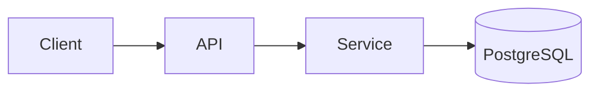

# DES — <module>

> 对齐 [[02-Design/standards/arch]]。子产物从 `_templates/` 复制到本模块目录。

## 架构

## 设计包索引

| 产物 | 路径 |
|------|------|
| 领域 | [[domain/ENT]] |
| DDL | [[ddl/schema.sql]] |
| API | [[api/API]] |
| Demo | demo/（按 point 建 DEMO.md） |

## 领域摘要

| ID | 聚合/实体 | F-ID |
|----|-----------|------|
| ENT-001 | | F-001 |

## API 追溯

| API-ID | Method | Path | F-ID |
|--------|--------|------|------|
| API-001 | | | |

## 测试要点

- [ ]

## 关联

[[01-Requirements/modules/<module>/<module>]]
[[02-Design/Design-Graph]]
[[02-Design/standards/README]]
