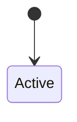

# ENT — <module>

> 对齐 [[02-Design/standards/domain]]。

## 有界上下文

（本模块在系统中的边界。）

## 聚合

### ENT-001 <AggregateName>

- **不变量**：
- **实体/值对象**：

| 属性 | 类型 | 说明 |
|------|------|------|

- **状态机**：

- **领域事件**：

## 仓储意图

| 场景 | 读/写 | 说明 |
|------|-------|------|

## 追溯

| ENT-ID | F-ID | SPEC |
|--------|------|------|
| ENT-001 | F-001 | [[01-Requirements/modules/<module>/.../SPEC\|SPEC]] |

## 关联

[[../DES-<module>]]
[[02-Design/standards/domain]]
